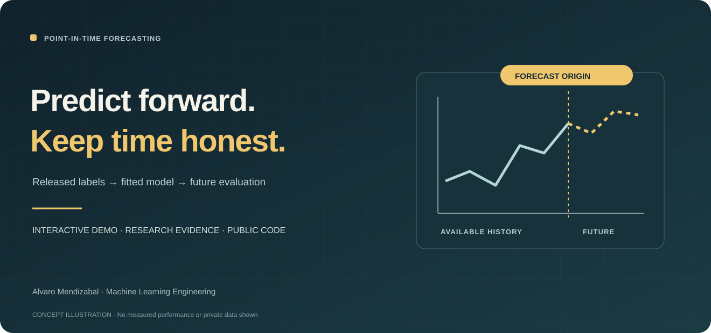
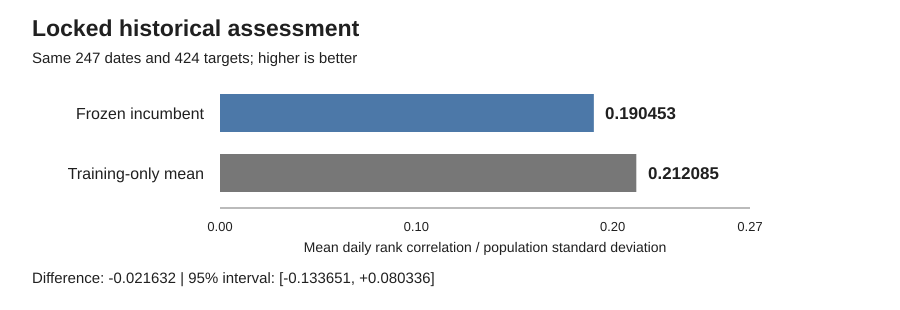
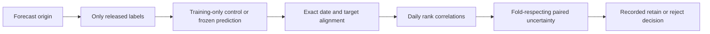

# Commodity Forecasting · Point-in-time evaluation

**Alvaro Mendizabal · Time-series ML · Delayed-label systems · Statistical evaluation**



[](https://github.com/alvaromendizabal/commodity-prediction/actions/workflows/quality.yml)

I built a forecasting evaluation system for **424 targets across four horizons**, with training-only selection, exact label-release accounting, paired temporal comparisons and reproducible diagnostics. The final research reference uses target-routed trees with retained covariance and persistence/retrieval components. Private fitting and routing specifications are not distributed.

[**Open Forecasting Lab ↗**](https://alvaro-forecasting-lab.tartmacaw2.chatgpt.site) · [Case study](docs/PORTFOLIO_CASE_STUDY.md) · [Reproduce the public checks](docs/REPRODUCIBILITY.md)

## The result is a decision, not a performance claim

| Population | Recorded comparison | Decision |
|---|---|---|
| Later temporal replication, 355 dates | Candidate **0.289365** vs reference **0.276025** | Positive estimate; interval crossed zero; not promoted |
| Locked historical assessment, 247 dates | Reference **0.190453** vs training-only mean **0.212085** | No demonstrated advantage; no post-assessment reselection |
| Delayed-label replay | **134 scored dates**, including a **73-date** terminal segment | Selection remained training-only |

The metric is mean daily cross-sectional rank correlation divided by its population standard deviation. It is **not annualized Sharpe, realized trading profit or a live investment strategy**. The original negative assessment and inconclusive comparison remain intact. [Original record](reports/portfolio_summary.json)



## Maintained engineering



| Concern | Actual public implementation | What it demonstrates |
|---|---|---|
| Delayed information | [Release calendar](examples/delayed_label_demo.py) | Future labels cannot enter an earlier snapshot |
| Metric fidelity | [Rank metric](src/commodity_prediction/metrics.py) | Ordered identities, missing targets, tied ranks and population standard deviation |
| Fair comparison | [Evaluation and paired blocks](src/commodity_prediction/studies/evaluation.py) | Fixed target populations and blocks contained within fitted folds |
| Interactive fitted control | [Browser engine](public-demo/engine.js) | Rolling, train-only fitting on authored synthetic series |
| Independent replay | [Replay verifier](tools/replay_public_demo.mjs) | Recompute actual browser outputs and reject modified exports |

## Run from a clone

No private data or cloud account is required:

```bash
python3 -S scripts/verify_portfolio.py
python3 -S examples/delayed_label_demo.py
python3 -S review/run.py --output /tmp/commodity-review --with-node
python3 -S review/run.py --output /tmp/commodity-review --with-node --check
```

Use Python 3.12; Node.js 22 or 24 enables actual browser and export-replay checks. With the locked Python environment, run `uv sync --frozen --extra dev`, then `uv run --frozen --extra dev python scripts/quality.py` and `uv run --frozen python scripts/execute_public_closeout.py`.

The [canonical executed review](notebooks/28_final_research_closeout.ipynb) replays public aggregate evidence. Forecasting Lab fits a reference on synthetic data and exposes label eligibility at every origin; it does not execute the private tree ensemble or reproduce its historical score.

## Publication boundary

The maintained tree contains final evaluation arithmetic, release-time contracts, the fitted public control, replay tests and compact original evidence. Superseded feature campaigns, unused model implementations, operator launchers and duplicate notebooks are removed. The compact historical selection ledger is retained for accountability, not advertised as a catalog of runnable model families.

Raw competition inputs, model weights, current feature identities and private routing recipes are excluded. No production deployment, unbiased future alpha or investment suitability is claimed. [Scope](docs/PUBLICATION_SCOPE.md) · [Source map](docs/REPOSITORY_GUIDE.md)
